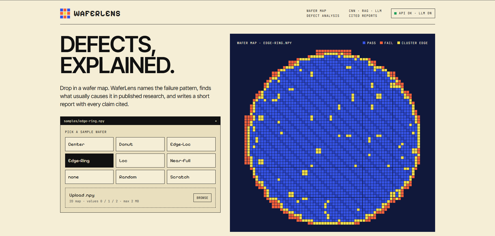
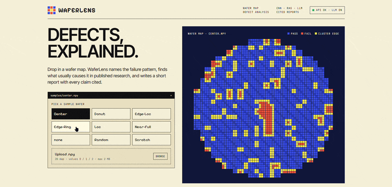
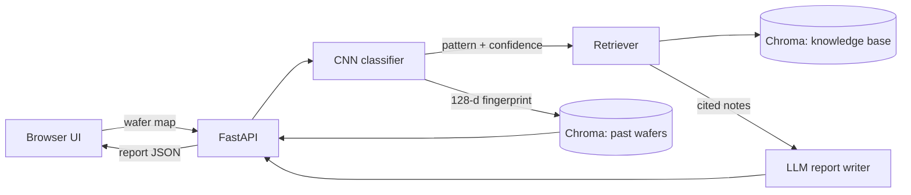
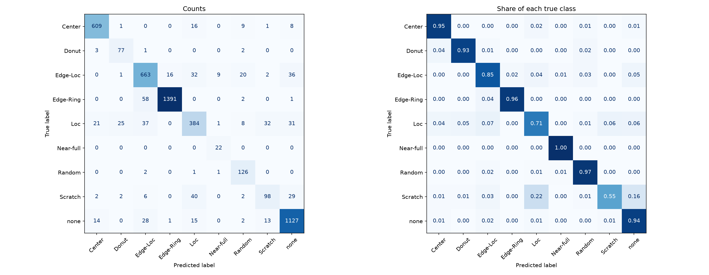

# WaferLens

**An AI assistant for semiconductor wafer defect analysis.** Upload a wafer map, and WaferLens identifies the failure pattern with a CNN, retrieves what typically causes it from a curated knowledge base of published research, and writes a short root-cause report with every claim cited.




Built with **PyTorch · ChromaDB · sentence-transformers · Gemini · FastAPI** on the real-world [WM-811K](https://doi.org/10.1109/TSM.2014.2364237) dataset (811,457 production wafer maps).

---

## Why this matters

After fabrication, every chip on a wafer is tested and marked pass or fail. Failed chips often form **spatial patterns** (a ring at the edge, a blob in the centre, a scratch line), and each pattern points to a different process problem. Engineers inspect these maps every day to decide which tool or step to investigate. WaferLens automates the first part of that workflow and shows its evidence.

## What it does

1. **Classifies** the wafer map into one of 9 patterns (Center, Donut, Edge-Loc, Edge-Ring, Loc, Near-full, Random, Scratch, none) and reports its confidence
2. **Flags uncertainty**: below 70% confidence it explains the top two candidates and how to tell them apart
3. **Retrieves** the relevant notes on causes and checks from a knowledge base written from peer-reviewed papers
4. **Writes a cited report** with an LLM that may use *only* those notes; invented citations are removed automatically
5. **Finds similar past wafers** using the CNN's 128-dimensional fingerprints

## Architecture



| Component | Implementation |
|---|---|
| Classifier | 3-block CNN in PyTorch, 64×64 input, class-weighted loss, rotation/flip augmentation |
| Knowledge base | 10 Markdown notes, one per pattern plus background, each claim tied to a source |
| Retrieval | `all-MiniLM-L6-v2` embeddings in ChromaDB; metadata filter on the predicted pattern, required sections always included |
| Report writer | Provider-agnostic LLM client (Gemini by default) with retry/backoff, prompt-hash caching, truncation detection and citation validation; falls back to a template report if the LLM is unavailable |
| Similar wafers | CNN fingerprints of 23,463 training wafers in ChromaDB, cosine similarity |
| API | FastAPI with Pydantic schemas, components loaded once at startup, `allow_pickle=False` uploads |
| UI | Plain HTML/CSS/JS served by the API; canvas-rendered wafer maps; escaped report rendering |

**Design principle:** numbers come from code, prose comes from the LLM. Pattern, confidence, similar-wafer counts and the source list are generated deterministically; the LLM only writes the explanation.

## Results

All numbers come from `results/*.json`, produced by the evaluation scripts (`python -m scripts.results_table`).

### Defect classifier (CNN)

**Test accuracy 89.4% · macro F1 0.832** (best epoch 26, held-out test set of 5,028 wafers)

| Pattern | Precision | Recall | F1 | Test wafers |
|---|---|---|---|---|
| Center | 0.94 | 0.95 | 0.94 | 644 |
| Donut | 0.73 | 0.93 | 0.81 | 83 |
| Edge-Loc | 0.83 | 0.85 | 0.84 | 779 |
| Edge-Ring | 0.99 | 0.96 | 0.97 | 1452 |
| Loc | 0.79 | 0.71 | 0.75 | 539 |
| Near-full | 0.67 | 1.00 | 0.80 | 22 |
| Random | 0.74 | 0.97 | 0.84 | 130 |
| Scratch | 0.67 | 0.55 | 0.60 | 179 |
| none | 0.92 | 0.94 | 0.93 | 1200 |

Rare classes (Donut, Near-full, Random) have high recall but lower precision: class weights make missing them expensive, so the model leans towards predicting them. Confidence is meaningful (90.2% average when right vs 60.4% when wrong); above the 70% threshold, accuracy is 96.3%.



### Similar past wafers

| Metric | Value |
|---|---|
| precision@5 (neighbours sharing the true label) | 88.9% |
| Majority vote of 5 neighbours, accuracy | 91.9% |
| Wafers evaluated | 1,000 |

The CNN's 128-dimensional fingerprints group wafers so well that a simple vote of the 5 nearest training wafers (91.9%) matches the classifier itself, so the similar wafers shown in each report are genuine evidence.

### Knowledge retrieval

| Metric | Value |
|---|---|
| Pattern-filtered retrieval checks passed | 9/9 |
| Free-text search, top-1 hit rate | 50% |
| Free-text search, top-3 hit rate | 75% |

The pipeline always filters by the predicted pattern, and that path passes every check. Unfiltered free-text search is a stress test of the embeddings alone: misses come from closely related patterns (for example edge questions matching Edge-Ring instead of Edge-Loc), which is why filtering is used.

### LLM reports

| Metric | Value |
|---|---|
| Reports evaluated | 18 |
| Written by the LLM (not the fallback) | 89% |
| All requested sections present | 100% |
| Bullets with a citation | 97% |
| Reports with overconfident wording | 0 |
| Uncertain reports covering both patterns | 100% |
| Report time, fresh LLM call | 24.1 s |
| Report time, cached | 220 ms |

The remaining 11% fell back to the template report when the free-tier LLM was unavailable, so a report was still returned every time. Fresh calls are slow on the free tier; caching by prompt makes repeat patterns near-instant.

## Example report

> **Pattern detected:** Center (98% confidence)
>
> **What this usually means:**
> - Often associated with irregular RF operation or unusual liquid flow during processing [S1]
> - Commonly linked to dispense and spin dynamics, or to effects at the centre of a process chamber [S2]
>
> **Suggested checks:**
> - Inspect the coat and develop modules first [S2]

More in [results/sample_reports.md](results/sample_reports.md).

## Quick start

**Requirements:** Python 3.11+, about 5 GB free disk, a free [Gemini API key](https://aistudio.google.com) (optional: without it, reports use the template fallback).

For the exact versions this was tested with: `pip install -r requirements.lock.txt`

```bash
git clone https://github.com/harshita-kode/wafer-lens.git
cd wafer-lens
python -m venv venv
venv\Scripts\activate            # macOS/Linux: source venv/bin/activate
pip install -r requirements.txt
copy .env.example .env           # macOS/Linux: cp .env.example .env, then add your key
```

**Get the data and model**

1. Download `LSWMD.pkl` (WM-811K) from Kaggle into `data/raw/`
2. Run the notebooks in order: `01_explore_data` → `02_prepare_data` → `03_train_cnn` (or download `wafer_cnn.pt` from the [v1.0 release](../../releases) into `models/` and run only the first two)

**Build the indexes and run**

```bash
python -m src.rag.ingest                  # knowledge base -> ChromaDB
python -m src.similar.index               # past-wafer fingerprints -> ChromaDB
python -m scripts.analyze_wafer --export-samples
uvicorn src.api.main:app
```

Open **http://127.0.0.1:8000** for the UI, or **/docs** for the interactive API.

## API

| Method | Path | Description |
|---|---|---|
| GET | `/health` | Which components are loaded |
| POST | `/analyze` | Analyse a wafer sent as JSON `{"wafer_map": [[...]]}` |
| POST | `/analyze/file` | Analyse an uploaded `.npy` file |
| GET | `/samples`, `/samples/{name}` | Example wafers |
| GET | `/past-wafers/{index}` | Map of a training wafer (for similar-wafer thumbnails) |

## Tests

```bash
python -m pytest
```

Covers preprocessing and the real classifier, retrieval, prompt construction and citation validation (with a fake LLM), LLM retry and caching, the pipeline, and every API endpoint including invalid input and pickle-upload rejection.

## Project structure

```
src/
  classifier/   model, preprocessing, inference
  rag/          knowledge-base ingestion and retrieval
  llm/          provider-agnostic client with retry and cache
  report/       prompt building and cited report writing
  similar/      fingerprint index and past-wafer store
  pipeline.py   classify -> similar -> retrieve -> report
  api/          FastAPI app and schemas
frontend/       HTML, CSS, JS
knowledge_base/ cited notes per defect pattern
notebooks/      exploration, preprocessing, training and evaluation
scripts/        evaluation, sample export, CLI, API client
tests/
```

## Limitations and next steps

- **Scratch and Loc are the weakest classes** (Scratch recall 0.55). Thin scratches can break up when large wafers are resized to 64×64; a resize that preserves thin lines, longer training or polar-coordinate features are promising next steps
- **One label per wafer.** Real wafers often contain mixed patterns; a multi-label model would match production data better
- **Reports explain the pattern, not the individual wafer.** The LLM output is cached per pattern; adding wafer-specific facts (fail rate, failure location) to the prompt would make reports more specific
- **Small knowledge base** (10 notes). A production version would use a fab's own failure-analysis records
- **The CNN uses a single grey channel.** A one-hot 3-channel encoding (no die / pass / fail) is worth testing

## Acknowledgements

- Wu, M.-J., Jang, J.-S. R., & Chen, J.-L. (2015). *Wafer Map Failure Pattern Recognition and Similarity Ranking for Large-Scale Data Sets.* IEEE Transactions on Semiconductor Manufacturing. The WM-811K dataset is not redistributed in this repository.
- Knowledge-base sources are listed in each note under `knowledge_base/`.